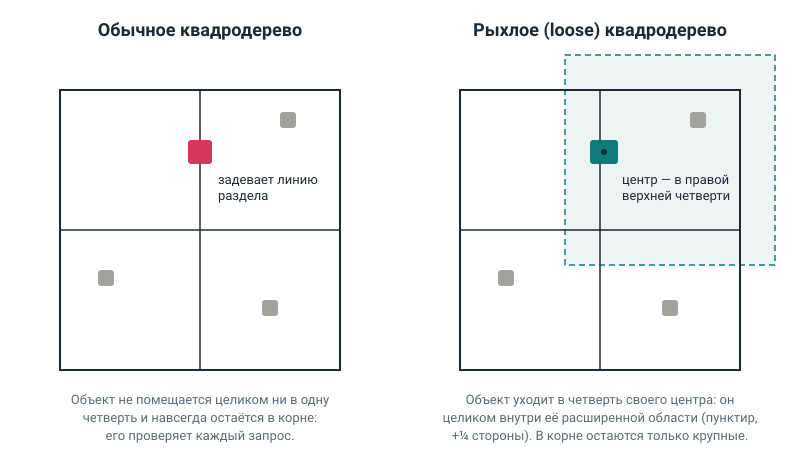

# loose-quadtree

[Русский](README.md) · **English**

Fast lookups for 2D shapes: which ones intersect a given shape, lie above or below it, or sit within a radius of a point. Objects can be added, moved and removed on the fly. Under the hood is a **loose quadtree**, so nearby searches barely slow down as the number of objects grows: a small query over a million objects checks about 16 of them, not all of them.

TypeScript, zero dependencies, types included. Good for games (targeting, explosions, crowd collisions), maps and editors — anywhere you need to find what is nearby, fast.

|                  |                                                                                                                                 |
| ---------------- | ------------------------------------------------------------------------------------------------------------------------------- |
| **Demo**         | [mrdingoro.github.io/loose-quadtree](https://mrdingoro.github.io/loose-quadtree/) — the tree live, the query follows the mouse  |
| **Presentation** | [mrdingoro.github.io/loose-quadtree/slides.html](https://mrdingoro.github.io/loose-quadtree/slides.html) — animated, in Russian |



## Install

```sh
npm install loose-quadtree
```

Runs in browsers and Node.js 18+. Use `import`; recent Node.js versions also support `require`.

## Example

```ts
import { SpatialSpace, rectangle, circle, point } from 'loose-quadtree';

const space = new SpatialSpace<string>();
space.add('wall', rectangle({ x: 0, y: 0, width: 10, height: 10 }), 'wall');
space.add('coin', point({ x: 12, y: 5 }), 'coin');
space.add('lamp', circle({ x: 5, y: -20, radius: 3 }), 'lamp');

space.findIntersections(circle({ x: 12, y: 5, radius: 2 })); // wall and coin
space.findInRadius({ x: 15, y: 5 }, 3); // coin
space.findAbove(rectangle({ x: 0, y: 0, width: 10, height: 10 })); // lamp
space.findBelow(circle({ x: 5, y: -20, radius: 3 })); // wall and coin

space.update('coin', point({ x: 100, y: 100 }), 'coin'); // the coin moved away
space.remove('wall');
```

Every query returns an array of `{ id, shape, data }`. The order is not guaranteed.

### Your own data instead of shapes

If you do not need shapes, use `SpatialIndex<T>`. It stores any value together with a bounding box `{ minX, minY, maxX, maxY }` and finds everything whose box intersects a given area.

```ts
import { SpatialIndex } from 'loose-quadtree';

type Enemy = { id: string; x: number; y: number };
const horde: Enemy[] = [
  { id: 'frog', x: 30, y: 40 },
  { id: 'crab', x: 200, y: 50 },
];
const box = (e: Enemy) => ({ minX: e.x - 8, minY: e.y - 8, maxX: e.x + 8, maxY: e.y + 8 });

const enemies = new SpatialIndex<Enemy>();
for (const e of horde) enemies.add(e.id, e, box(e));

enemies.query({ minX: 0, minY: 0, maxX: 100, maxY: 100 }); // [{ id: 'frog', value, bounds }]

// The index does not track objects by itself: call update after they move.
for (const e of horde) e.x += 150;
for (const e of horde) enemies.update(e.id, e, box(e));
```

More examples, including the nearest enemy within a radius, are in [`examples/basics.ts`](examples/basics.ts).

## Reference

### Methods

|        | `SpatialSpace<T>` — shapes                                    | `SpatialIndex<T>` — any data                     |
| ------ | ------------------------------------------------------------- | ------------------------------------------------ |
| Add    | `add(id, shape, data)`                                        | `add(id, value, bounds)`                         |
| Move   | `update(id, shape, data)`                                     | `update(id, value, bounds)`                      |
| Remove | `remove(id)` → `true`, or `false` if there is no such id      | `remove(id)` → the same                          |
| Find   | `findIntersections`, `findAbove`, `findBelow`, `findInRadius` | `query(area)` → array of `{ id, value, bounds }` |
| Other  | `has(id)`, `get(id)`, `clear()`, property `size`              | `has(id)`, `get(id)`, `clear()`, property `size` |

Shapes: `rectangle({ x, y, width, height })`, where (x, y) is the top-left corner; `circle({ x, y, radius })`; `point({ x, y })`.

### What the queries mean

The Y axis points down, as on a screen.

- **Intersection** — touching counts.
- **Above / below** — the object lies entirely above the shape's top edge (or entirely below its bottom edge). X is not restricted: the whole area above the shape is searched.
- **Within radius** — the distance is measured to the nearest point of the shape, not to its centre.

### Options

`new SpatialSpace({ capacity, looseness })` and `new SpatialIndex({ capacity, looseness })`:

- `capacity` — how many objects a cell holds before it splits. An integer from 1, default 8.
- `looseness` — the cell margin as a fraction of its side. A number from 0 to 1, default 0.25. With 0 you get a plain quadtree.

### Errors

After any error the index stays exactly as it was.

- `RangeError` — invalid numbers: `NaN`, infinity, negative size, a box whose minimum is greater than its maximum, invalid `capacity` or `looseness`.
- `TypeError` — the id is not a string, or the shape is unknown.
- `Error` — a duplicate id in `add`, or an unknown id in `update`.

## Limitations

- **The query finds almost everything** (for example, "everything below" on a large field). No method can return such an answer faster than listing every object found, so the tree is barely faster than a full scan here.
- **Few objects that move every frame.** Queries alone are faster than a full scan even with hundreds of objects, but updating the tree every frame costs more: in a game with 100 enemies a plain loop wins (see the game frame below).
- **Many huge objects** (a quarter of the world in size). They do not fit into small cells and slow down every query, although the tree is still faster than a full scan.
- **The tree only grows.** If objects fly far away and come back, the large tree stays until `clear()`.

## Benchmarks

The query is a 16×16 square at a random spot. The world grows with the number of objects, so the square always covers about the same number of them.

"Checked" is how many objects the query compared one by one; it does not depend on the machine. Time is the average per query (20,000 queries, best of three runs), Node.js 22, a cloud machine with two Intel Xeon cores.

|   Objects | Plain tree: checked | Loose: checked | Plain, µs | Loose, µs | Full scan, µs |
| --------: | ------------------: | -------------: | --------: | --------: | ------------: |
|     1,000 |                  19 |             17 |       0.6 |       1.2 |            14 |
|    10,000 |                  44 |             17 |       2.3 |       2.7 |           128 |
|   100,000 |                 151 |             16 |       6.2 |       6.5 |         1,385 |
| 1,000,000 |                 356 |             15 |        19 |        15 |        21,285 |

In the loose tree the number of checked objects does not grow (17 → 15); in the plain tree it grows almost 19 times.

A game frame with a horde of enemies ([`examples/horde.ts`](examples/horde.ts)): enemies walk towards the player and push each other apart, six guns look for a target, a grenade explodes.

| Enemies | With index, ms/frame | Full scan, ms/frame |
| ------: | -------------------: | ------------------: |
|     100 |                 0.65 |                0.23 |
|   1,000 |                  3.0 |                 5.2 |
|   3,000 |                   18 |                  38 |
|  10,000 |                   87 |                 368 |

More data sets and a detailed explanation of how the tree works are in the [Russian README](README.md#о-курсовой).

## How it works, briefly

A quadtree splits a square into four quarters, and an overcrowded quarter into four again; a query only descends into the quarters it touches. In a plain quadtree an object lying on a dividing line fits into no quarter and stays near the root, where almost every query has to check it. A **loose quadtree** picks the quarter by the object's centre and gives each quarter a margin of ¼ of its side: a small object on a dividing line now fits into the quarter with its margin and goes down, and only large objects stay at the top.

This library started as a university course project on the topic "A library for finding intersections of a shape with a set of shapes".

## Development

```sh
npm install
npm test               # tests
npm run lint           # ESLint
npm run build          # build into dist/
npm run benchmark      # benchmarks (about 5 minutes; faster: npm run benchmark -- --sizes 1000,10000)
npm run example:basics # examples
npm run example:horde  # game frame: index vs full scan
npm run demo           # demo and presentation at http://localhost:8080
```

## License

MIT
