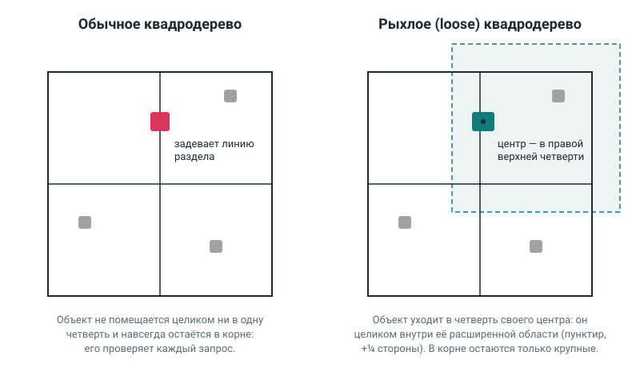
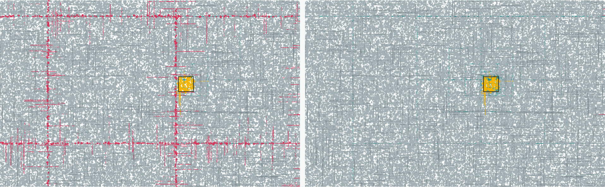

# loose-quadtree

**Русский** · [English](README.en.md)

Быстрый поиск фигур на плоскости: какие пересекаются с данной, лежат выше, ниже или рядом с точкой. Объекты можно добавлять, двигать и удалять на лету. Внутри — **рыхлое квадродерево**, поэтому поиск рядом почти не замедляется, когда объектов становится больше: небольшой запрос на миллионе объектов проверяет около 16 из них, а не все.

TypeScript, без зависимостей, типы в комплекте. Подходит для игр (цели, взрывы, столкновения толпы), карт и редакторов — везде, где нужно быстро найти, что рядом.

|                 |                                                                                                                                              |
| --------------- | -------------------------------------------------------------------------------------------------------------------------------------------- |
| **Демо**        | [mrdingoro.github.io/loose-quadtree](https://mrdingoro.github.io/loose-quadtree/) — дерево вживую, запрос ведётся мышью                      |
| **Презентация** | [mrdingoro.github.io/loose-quadtree/slides.html](https://mrdingoro.github.io/loose-quadtree/slides.html) — с анимациями, листается стрелками |



## Установка

```sh
npm install loose-quadtree
```

Работает в браузере и в Node.js 18+. Подключается через `import`; в свежих версиях Node.js работает и `require`.

## Пример

```ts
import { SpatialSpace, rectangle, circle, point } from 'loose-quadtree';

const space = new SpatialSpace<string>();
space.add('wall', rectangle({ x: 0, y: 0, width: 10, height: 10 }), 'стена');
space.add('coin', point({ x: 12, y: 5 }), 'монета');
space.add('lamp', circle({ x: 5, y: -20, radius: 3 }), 'фонарь');

space.findIntersections(circle({ x: 12, y: 5, radius: 2 })); // стена и монета
space.findInRadius({ x: 15, y: 5 }, 3); // монета
space.findAbove(rectangle({ x: 0, y: 0, width: 10, height: 10 })); // фонарь
space.findBelow(circle({ x: 5, y: -20, radius: 3 })); // стена и монета

space.update('coin', point({ x: 100, y: 100 }), 'монета'); // монета уехала
space.remove('wall');
```

Каждый запрос возвращает массив объектов `{ id, shape, data }`. Порядок в массиве не гарантирован.

### Свои данные вместо фигур

Если фигуры не нужны, есть `SpatialIndex<T>`. Он хранит что угодно вместе с прямоугольной рамкой `{ minX, minY, maxX, maxY }` и находит всё, чья рамка пересекает заданную область.

```ts
import { SpatialIndex } from 'loose-quadtree';

type Enemy = { id: string; x: number; y: number };
const horde: Enemy[] = [
  { id: 'frog', x: 30, y: 40 },
  { id: 'crab', x: 200, y: 50 },
];
const box = (e: Enemy) => ({ minX: e.x - 8, minY: e.y - 8, maxX: e.x + 8, maxY: e.y + 8 });

const enemies = new SpatialIndex<Enemy>();
for (const e of horde) enemies.add(e.id, e, box(e));

enemies.query({ minX: 0, minY: 0, maxX: 100, maxY: 100 }); // [{ id: 'frog', value, bounds }]

// Индекс сам за объектами не следит: после движения нужно вызвать update.
for (const e of horde) e.x += 150;
for (const e of horde) enemies.update(e.id, e, box(e));
```

Больше примеров, в том числе поиск ближайшего врага в радиусе, — в [`examples/basics.ts`](examples/basics.ts).

## Справочник

### Методы

|             | `SpatialSpace<T>` — фигуры                                        | `SpatialIndex<T>` — любые данные                 |
| ----------- | ----------------------------------------------------------------- | ------------------------------------------------ |
| Добавить    | `add(id, shape, data)`                                            | `add(id, value, bounds)`                         |
| Переместить | `update(id, shape, data)`                                         | `update(id, value, bounds)`                      |
| Удалить     | `remove(id)` → `true`, или `false`, если такого id нет            | `remove(id)` → то же                             |
| Найти       | `findIntersections`, `findAbove`, `findBelow`, `findInRadius`     | `query(area)` → массив `{ id, value, bounds }`   |
| Ещё         | `has(id)`, `get(id)`, `clear()`, свойство `size` — число объектов | `has(id)`, `get(id)`, `clear()`, свойство `size` |

Фигуры: `rectangle({ x, y, width, height })`, где (x, y) — левый верхний угол; `circle({ x, y, radius })`; `point({ x, y })`.

### Как понимать запросы

Ось Y направлена вниз, как на экране.

- **Пересечение** — касание тоже считается.
- **Выше / ниже** — объект целиком выше верхнего края фигуры (или целиком ниже нижнего). По X ограничения нет: ищется всё пространство над фигурой.
- **В радиусе** — расстояние считается до ближайшей точки фигуры, а не до её центра.

### Настройки

`new SpatialSpace({ capacity, looseness })` и `new SpatialIndex({ capacity, looseness })`:

- `capacity` — сколько объектов ячейка держит, прежде чем делиться. Целое число от 1, по умолчанию 8.
- `looseness` — запас ячейки в долях её стороны. Число от 0 до 1, по умолчанию 0,25. При 0 получается обычное квадродерево.

### Ошибки

При любой ошибке индекс остаётся таким, каким был.

- `RangeError` — некорректные числа: `NaN`, бесконечность, отрицательный размер, минимум рамки больше максимума, неверные `capacity` или `looseness`.
- `TypeError` — id не строка или неизвестная фигура.
- `Error` — повторный id в `add` или неизвестный id в `update`.

## Ограничения

- **Запрос находит почти всё** (например, «всё ниже» на большом поле). Выдать такой ответ быстрее, чем перебрав все найденные объекты, нельзя — дерево тут почти не быстрее перебора.
- **Объектов мало и они двигаются каждый кадр.** Сами запросы и на сотнях объектов быстрее перебора, но обновлять дерево каждый кадр дороже: в игре со 100 врагами перебор выходит быстрее (см. [кадр игры](#замеры)).
- **Много огромных объектов** (размером с четверть мира). Они не помещаются в мелкие ячейки и замедляют каждый запрос, хотя дерево всё равно быстрее перебора.
- **Дерево только растёт.** Если объекты улетели далеко и вернулись, большое дерево остаётся до `clear()`.

## Разработка

```sh
npm install
npm test               # автотесты
npm run lint           # ESLint
npm run build          # сборка в dist/
npm run benchmark      # замеры (около 5 минут; быстрее: npm run benchmark -- --sizes 1000,10000)
npm run example:basics # примеры
npm run example:horde  # кадр игры: индекс против перебора
npm run demo           # демо и презентация на http://localhost:8080
```

```text
src/          библиотека
tests/        автотесты; against-brute-force — сверка с полным перебором
benchmarks/   замер «время запроса от числа объектов»
examples/     примеры использования и кадр игры с ордой врагов
demo/         страница для GitHub Pages: визуализатор и презентация
scripts/      локальный сервер для демо
docs/         картинки для README
```

Демо и презентация публикуются на GitHub Pages автоматически при каждом push ([`.github/workflows/pages.yml`](.github/workflows/pages.yml)).

---

## О курсовой

Это курсовая по теме **«Библиотека определения пересечения геометрии фигуры и набора фигур»**.

> Необходимо реализовать библиотеку, которая предоставляет API для быстрого определения положения объекта относительно множества других объектов в двумерном пространстве. Для каждого объекта известны координаты (x, y), ширина и высота.
>
> Библиотека должна поддерживать динамическое добавление и удаление объектов из набора, при этом сохраняя высокую производительность запросов. Необходимо предоставить набор методов для поиска объектов, находящихся выше/ниже, пересекающихся с заданным, и других подобных операций. Алгоритм должен быть реализован максимально эффективно: время выполнения запроса не должно существенно зависеть от общего количества объектов в наборе, а операции добавления/удаления не должны приводить к полному перестроению структур данных.

| Требование                          | Как выполнено                                                                          |
| ----------------------------------- | -------------------------------------------------------------------------------------- |
| Объекты с x, y, шириной и высотой   | `rectangle({ x, y, width, height })`, а также круг и точка                             |
| Добавление и удаление на лету       | `add`, `update`, `remove` меняют одну ветку дерева, дерево не перестраивается          |
| Пересечения, выше, ниже, «и другие» | `findIntersections`, `findAbove`, `findBelow`, `findInRadius`                          |
| Время запроса почти не зависит от n | небольшой запрос проверяет ~16 объектов и на тысяче, и на миллионе ([замеры](#замеры)) |
| Корректность                        | автотесты; главный из них сверяет все запросы с полным перебором на случайных данных   |

### Как это работает

Структуру, которая ускоряет поиск по координатам, называют **пространственным индексом** (spatial index) — по аналогии с индексом в базе данных. Основные варианты:

| Структура         | Сильная сторона                                                    | Почему выбрана не она                                                                       |
| ----------------- | ------------------------------------------------------------------ | ------------------------------------------------------------------------------------------- |
| Полный перебор    | проще некуда                                                       | каждый запрос проходит все n объектов                                                       |
| Равномерная сетка | очень быстра на объектах одного размера                            | нужно подобрать размер ячейки; крупный объект попадает во много ячеек, мелкие кучи — в одну |
| R-дерево          | хорошо группирует объекты, особенно если данные загружены разом    | вставка и удаление заметно сложнее в реализации: узлы приходится делить и перебалансировать |
| **Квадродерево**  | простое, не нужно знать границы мира, изменения трогают одну ветку | на объектах у линий раздела проседает — это и исправляет рыхлый вариант                     |

**Квадродерево** делит квадрат на четыре четверти, а переполненную четверть — снова на четыре. Запрос спускается только в те четверти, которые задевает, поэтому почти весь мир он не трогает.

**Проблема обычного квадродерева.** Объект, который задевает линию раздела, не помещается ни в одну четверть и остаётся в верхнем узле. Таких объектов тем больше, чем больше мир, а проверяет их почти каждый запрос. Замер это подтвердил: на миллионе объектов запрос в маленьком квадрате проверял 356 объектов, а на плотных кучах — 8 720.

**Рыхлое квадродерево** это исправляет (схема вверху):

1. Четверть для объекта выбирается по **центру** его прямоугольника.
2. У каждой четверти есть **запас** — ¼ стороны во все стороны. Объект спускается, если целиком помещается в четверть с запасом. Так мелкий объект на линии раздела уходит вниз, а наверху остаются только крупные.
3. Все объекты поддерева лежат внутри его области с запасом. Поэтому запрос пропускает узел, если не задевает эту область, и забирает поддерево целиком без проверок, если накрывает её полностью.

Почему запас ¼, а не ½, как в учебниках: с ½ соседние области сильнее перекрываются, и запрос заходит в лишние узлы. На миллионе мелких объектов: ¼ — 16 мкс, ½ — 28 мкс.

**Изменения на лету.**

- **Добавление.** Объект спускается от корня до своего узла. Если в узле стало больше 8 объектов, делится только этот узел. Если объект за пределами корня, корень удваивается в его сторону, а старое дерево целиком становится одной из четвертей нового.
- **Удаление.** Таблица `id → узел` сразу находит объект. Если после удаления четыре соседних узла почти опустели, они склеиваются обратно — иначе движущиеся объекты оставляли бы за собой тысячи пустых узлов.
- **Перемещение** — удаление и вставка.

**Сложность.** Каждая операция проходит один путь от корня до нужной ячейки. На тысяче объектов это в среднем около 5 шагов, на миллионе — около 10: путь растёт как log n. Запросу к этому добавляется проверка найденных объектов.

### Замеры

`npm run benchmark` ([`benchmarks/scaling.ts`](benchmarks/scaling.ts)). Запрос — квадрат 16×16 в случайном месте. Мир растёт вместе с числом объектов, поэтому в такой квадрат всегда попадает примерно одно и то же их число.

«Проверено» — сколько объектов запрос сравнил поштучно; это число не зависит от компьютера. Время — среднее на один запрос (20 000 запросов, лучший из трёх прогонов), Node.js 22, облачная машина с двумя ядрами Intel Xeon.

|  Объектов | Обычное дерево: проверено | Рыхлое: проверено | Обычное, мкс | Рыхлое, мкс | Перебор, мкс |
| --------: | ------------------------: | ----------------: | -----------: | ----------: | -----------: |
|     1 000 |                        19 |                17 |          0,6 |         1,2 |           14 |
|    10 000 |                        44 |                17 |          2,3 |         2,7 |          128 |
|   100 000 |                       151 |                16 |          6,2 |         6,5 |        1 385 |
| 1 000 000 |                       356 |                15 |           19 |          15 |       21 285 |

У рыхлого дерева число проверенных объектов не растёт: 17 → 15. У обычного — растёт почти в 19 раз. На тысяче объектов рыхлое дерево медленнее обычного: запасы соседних ячеек перекрываются, и запрос заходит в лишние.

<details>
<summary>Ещё два набора данных: плотные кучи и огромные объекты</summary>

**Четыре плотные кучи с повторяющимися координатами** — главный выигрыш: обычное дерево проверяет тысячи застрявших наверху объектов, рыхлое — почти ничего.

|  Объектов | Обычное дерево: проверено | Рыхлое: проверено | Обычное, мкс | Рыхлое, мкс | Перебор, мкс |
| --------: | ------------------------: | ----------------: | -----------: | ----------: | -----------: |
|     1 000 |                        28 |                 2 |         0,45 |        0,44 |          8,9 |
|    10 000 |                       114 |                 4 |         0,64 |        0,31 |          185 |
|   100 000 |                     2 833 |                37 |           15 |        0,55 |          816 |
| 1 000 000 |                     8 720 |                 0 |          242 |        0,20 |       17 769 |

**Каждый десятый объект огромный (четверть мира).** Запрос честно находит их всё больше, поэтому время растёт; рыхлое дерево быстрее обычного в 1,3–2,3 раза.

|  Объектов | Обычное дерево: проверено | Рыхлое: проверено | Обычное, мкс | Рыхлое, мкс | Перебор, мкс |
| --------: | ------------------------: | ----------------: | -----------: | ----------: | -----------: |
|     1 000 |                        92 |                43 |          1,7 |         1,4 |          9,5 |
|    10 000 |                       599 |               300 |          8,6 |         6,6 |          256 |
|   100 000 |                     6 309 |             3 072 |          137 |          80 |        1 389 |
| 1 000 000 |                    79 660 |            26 492 |        2 447 |       1 066 |       20 238 |

</details>

**Кадр игры с ордой врагов.** [`examples/horde.ts`](examples/horde.ts) повторяет кадр игры-арены: враги идут к игроку и расталкиваются, шесть стволов ищут цель, взрывается граната. Одна и та же работа — с индексом и полным перебором (`npm run example:horde`).

| Врагов | С индексом, мс/кадр | Перебор, мс/кадр |                           |
| -----: | ------------------: | ---------------: | ------------------------- |
|    100 |                0,65 |             0,23 | перебор быстрее в 3 раза  |
|    300 |                 1,3 |              0,5 | перебор быстрее           |
|  1 000 |                 3,0 |              5,2 | индекс быстрее в 1,7 раза |
|  3 000 |                  18 |               38 | индекс быстрее в 2 раза   |
| 10 000 |                  87 |              368 | индекс быстрее в 4 раза   |

На сотнях врагов индекс не нужен: обновлять дерево каждый кадр дороже, чем сделать несколько тысяч сравнений. Он окупается на тысячах: перебор растёт как n², индекс — почти линейно.

### Демо

[mrdingoro.github.io/loose-quadtree](https://mrdingoro.github.io/loose-quadtree/) показывает дерево вживую: ячейки, узлы, в которые зашёл запрос, и их запас. Запрос ведётся мышью — квадрат, круг, «выше» или «ниже». Дерево можно переключить на «обычное» и увидеть застрявшие объекты, а галочка «двигать объекты» показывает `update` каждый кадр. Фон страницы — игра «Жизнь» на том же `SpatialIndex`.



Один и тот же запрос на 50 000 фигур. Слева обычное дерево: около тысячи объектов застряло вдоль линий раздела (малиновые полосы), запрос проверяет 1 875 объектов. Справа рыхлое — 319.

### Как читать код

Весь код библиотеки — шесть файлов в `src/`, каждый следующий опирается на предыдущие:

1. [`aabb.ts`](src/aabb.ts) — прямоугольная рамка объекта и проверки «пересекаются», «вложен».
2. [`shapes.ts`](src/shapes.ts) — прямоугольник, круг, точка и их рамки.
3. [`geometry.ts`](src/geometry.ts) — точное пересечение фигур и расстояние до фигуры.
4. [`quadtree.ts`](src/quadtree.ts) — **рыхлое квадродерево, главная часть**.
5. [`spatial-index.ts`](src/spatial-index.ts) — обёртка над деревом: проверяет входные данные, хранит объекты по id.
6. [`spatial-space.ts`](src/spatial-space.ts) — запросы из задания.

## Лицензия

MIT
